# ReviewAgent Token 优化总体方案（E-only）

> **文档状态**：2026-11-10 重构为设计文档。适用分支 `main` / `production/e-only`。
>
> **文档定位**：先定义 ReviewAgent Token 优化的目标态设计，再说明当前 E-only 实现、消耗现状和落地计划。本文是总体方案设计，不是“当前能力说明书”，也不是单纯的问题分析报告。
>
> **设计目标**：以稳定前缀、按需上下文、有界循环、可解释缓存和证据闸为基础，将生产 E 的 `totalTokens` 控制到 C 锚的 20~30%，同时 Recall 和 Precision 相对优化前基线不得下降，允许的最大劣化上限为 5%。
>
> **当前状态摘要**：本地 pi 矩阵中 E/C `totalTokens` 约 34.6%，CARC 约 87.5%，cacheHit 约 60.6%。因此 20~30% 是目标，不是当前已达成的结果。详细的当前消耗与实现基线见第 11、12 章。
>
> **边界**：A–E 矩阵、judge 链、Phase 2 runner 和原始主数据分析属于 Demo 线 `demo/config-matrix`（冻结标签 `demo-config-matrix-baseline-2026-11-03`）。本文只在解释锚点或历史数据时引用，不把它们写成当前主线能力。

---

## 阅读路径

```text
设计目标与约束
→ 总体优化架构
→ 观测、预算、Context、缓存、质量设计
→ 竞争力机制对照与取舍
→ 当前 E-only 消耗与实现基线
→ P0/P1/P2 落地路线
→ 统一验收门
```

证据标签：

| 标记 | 含义 |
|---|---|
| **目标设计** | 本文定义的期望能力，不等于已经落地 |
| **已实现** | 当前 `main` 代码可验证 |
| **实测** | 有本地运行数据，但尚未形成主线可复现指标链 |
| **部分实现** | 行为存在，但边界、计量或收益尚未闭合 |
| **未实现** | 后续候选机制 |
| **Demo/历史** | 属于研究矩阵、旧配置或外部参照 |

---

# 第一部分：目标态设计

## 1. 设计目标与不可突破的约束

### 1.1 目标函数

Token 优化不是单点压缩 Prompt，而是优化单位 Token 的检视智能：

```text
目标 = 检视质量 / Token 成本
```

本方案同时优化四个成本项：

1. 请求输入重发；
2. 模型输出；
3. 无效工具调用与错误重试；
4. 缓存命中价格与 provider 差异。

### 1.2 目标指标

主 Token 判据沿用 ADR-0004：

```text
E.totalTokens <= C.totalTokens × 30%
E.Recall >= C.Recall × 90%
E.Precision >= C.Precision × 100%
E.cacheHitRate >= 85%
```

同时报告 CARC、cached input、uncached input、output 和工具尝试次数。`cacheHitRate` 只作为解释变量，不作为目标函数。

### 1.3 质量不劣化硬约束

任何 Token 优化都必须通过相对优化前基线的质量回归门：

```text
candidate.Recall    >= baseline.Recall    × 0.95
candidate.Precision >= baseline.Precision × 0.95
```

其中：

- `baseline` 使用同一内核版本、数据集、模型、provider、判定链和时间窗；
- 默认目标是不劣化；
- 最大允许劣化为 5%，即候选指标不得低于基线的 95%；
- 5% 是失败上限，不是优化目标；
- rule 与 judge 两套 Recall / Precision 都要分别报告；
- 同时报告 F1、Finding 数、零 Finding 率、样本量和 95% 置信区间；
- 主判据使用 rep2+ 热口径，rep1 冷口径单列；
- 基线为 0 或 null 时，相对比例门不可用，必须改用绝对百分点并标注。

质量门优先于 Token 收益。只要 Recall 或 Precision 的下降超过 5%，方案即失败。

### 1.4 设计原则

1. **可归因**：任何优化必须说明节省来自 cached、uncached、output、工具次数还是重试。
2. **有界性**：请求数、轮数、工具执行数、工具尝试数和输出都必须可封顶。
3. **前缀稳定**：稳定内容在前，动态内容只追加；任何改写或裁剪都必须显式报告。
4. **只读与证据**：不引入写工具、执行型 REPL；所有 Finding 仍需通过 Evidence Gate。
5. **质量优先**：任何 Token 收益都不能抵消超过 5% 的 Recall / Precision 劣化。
6. **渐进扩展**：compaction、repo map、artifact 和子 agent 只在大 MR 或多语言场景立项，不提前放开自由循环。

### 1.5 非目标

- 不追求“尽可能少调用工具”而牺牲证据覆盖；
- 不把缓存命中率单独当作成功标准；
- 不把历史 B 配置数字当成当前 E 成果；
- 不引入无限自由循环、Python REPL 或写工具；
- 不在没有消融数据的情况下自动切换模型或 provider。

---

## 2. 总体优化架构

### 2.1 成本因果链

```text
totalTokens
= Σ request_i.inputTokens
  + outputTokens

request_i.inputTokens
≈ 稳定前缀
  + 初始 MR 上下文
  + 已累积的阶段指令
  + 已累积的 assistant / tool 消息
```

总成本受以下杠杆影响：

| 杠杆 | 典型现象 | 目标设计 |
|---|---|---|
| 请求数 | 历史随阶段和工具结果持续增长 | 请求硬预算与阶段收尾 |
| 工具尝试 | 执行次数受限，但模型继续尝试 | attempts 独立预算 |
| 无效工具 | 空 rule/history 仍被调用 | 动态 core-5 / extended-7 |
| 重复读取 | Ledger 未命中或范围失真 | 身份键、送达范围、complete |
| 截断重读 | 检索结果被行前缀截断 | 工具级截断策略 |
| 缓存单价 | 命中率受路由、预热和价格影响 | CacheContract 与价目表 |
| 长上下文 | 大 MR 才需要压缩 | P1/P2 受控扩展 |

### 2.2 总架构图

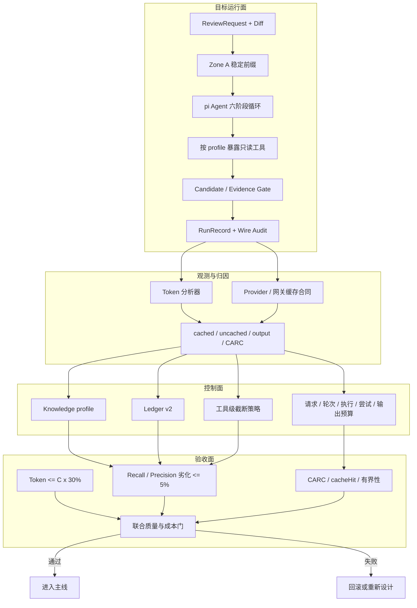

### 2.3 优化闭环


### 2.4 目标态分层

| 层 | 核心能力 | 主要产物 |
|---|---|---|
| 运行层 | E-only 六阶段检视 | RunRecord / Audit |
| 观测层 | usage、请求、工具、缓存归因 | Token 分析报告 |
| 控制层 | 预算、工具 profile、截断、Ledger | 有界运行轨迹 |
| 缓存层 | 稳定前缀、provider 合同、prefix 预测 | CacheContract / cache 报告 |
| 验收层 | 质量、成本、缓存、有界性 | 消融结论 |

---

## 3. 观测与成本归因设计

### 3.1 四行主报告

目标报告固定输出：

```text
cachedInputTokens
uncachedInputTokens
outputTokens
CARC
```

辅助字段：

```text
totalTokens
cacheHitRate
requests
executedToolCalls
attemptedToolCalls
skippedToolCalls
toolCostTokens
retryCostTokens
summaryCostTokens
```

### 3.2 CARC 定义

默认 token 口径：

```text
CARC = uncachedInputTokens
     + cacheWriteTokens
     + outputTokens
     + toolCostTokens
```

retry / summary 成本独立报告（字段缺失记 null）；是否纳入 CARC 需先修订 ADR-0017 的 L2 主指标定义，不随本方案默认改变。

若提供价目表，再输出货币口径：

```text
cachedCost = cachedInputTokens × cacheHitPrice
uncachedCost = uncachedInputTokens × cacheMissPrice
outputCost = outputTokens × outputPrice
```

没有价目表时只输出 token-equivalent CARC，不冒充真实货币账单。

### 3.3 Token 分析器架构

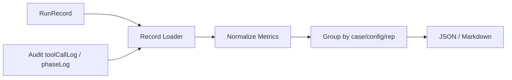

设计要求：

- 单命令可从 RunRecord / Audit 复算；
- 不读取 API key，不发起网络请求；
- 输出确定性，不依赖当前时间或文件遍历顺序；
- 同时输出请求数、工具尝试数、执行数、跳过数与截断原因；
- 冷热分层（rep1 冷口径 vs rep2+ 热口径）属评测 campaign，不在主线分析器实现（#49 §1）。

### 3.4 Provider 缓存合同

```ts
interface CacheContract {
  provider: string;
  endpointKind: string;
  requestedModel: string;
  respondedModel?: string;
  deploymentVersion?: string;
  usageFieldFamily:
    | "deepseek-native"
    | "openai-cached-tokens"
    | "unknown";
  cacheMetering: boolean;
  cacheBlockTokens?: number;
  cacheWarmupMs?: number;
  providerAffinityRequired?: boolean;
  cacheHitPrice?: number;
  cacheMissPrice?: number;
  cacheWritePrice?: number;
  currency?: string;
  priceValidFrom?: string;
  measuredAt: string;
}
```

缓存合同必须回答：

- usage 字段族；
- 是否支持缓存计量；
- 预热窗口；
- 块对齐；
- 路由亲和；
- 实际价格；
- 模型部署版本；
- 测量时间窗。

缺少字段时标记 unknown / N/A，不得按 0 或固定 1/30 假设处理。

---

## 4. 请求、轮次与输出控制设计

### 4.1 五类独立预算

```ts
MAX_REQUESTS
MAX_ROUNDS
MAX_EXECUTED_TOOL_CALLS
MAX_TOOL_ATTEMPTS
MAX_OUTPUT_TOKENS
```

建议候选值：

| 预算 | 安全上界 | 优化候选 | 说明 |
|---|---:|---:|---|
| `MAX_REQUESTS` | 24 | 16 / 20 / 24 | 防失控，候选需消融 |
| `MAX_ROUNDS` | 5 | 5 | 保持六阶段轮次上界 |
| `MAX_EXECUTED_TOOL_CALLS` | 6 | 4 / 6 | 6 是当前行为，4 需质量验证 |
| `MAX_TOOL_ATTEMPTS` | 12 | 8 / 10 / 12 | 每次模型发起 toolCall 都计数 |
| `MAX_OUTPUT_TOKENS` | 48,000 | 32,000 / 40,000 / 48,000 | 当前本地采样均值约 16.4k |

### 4.2 计数语义

1. 每发起一次模型请求，`requestCount += 1`；
2. 模型每发起一个 toolCall，`attemptedToolCalls += 1`；
3. 实际进入工具执行，`executedToolCalls += 1`；
4. 超预算未执行，`skippedToolCalls += 1`；
5. 每收到 assistant usage，累计 `outputTokens`；
6. 预算检查在下一请求前执行。

### 4.3 预算耗尽后的收口

- 当前工具批返回 `terminate` 语义；
- 或由 `shouldStopAfterTurn` 强制进入阶段收尾；
- 记录 `BUDGET_EXHAUSTED_FORCED_FINALIZATION`；
- 不伪造 Finding；
- 不把半成品当作完整检视；
- RunRecord 写 `truncated=true` 和具体原因。

### 4.4 停止原因

```text
MODEL_COMPLETE
MODEL_STOPPED
MAX_REQUESTS_REACHED
MAX_ROUNDS_REACHED
TOOL_ATTEMPTS_EXHAUSTED
TOOL_BUDGET_EXHAUSTED
OUTPUT_BUDGET_EXHAUSTED
PHASE_INCOMPLETE
```

### 4.5 控制面架构

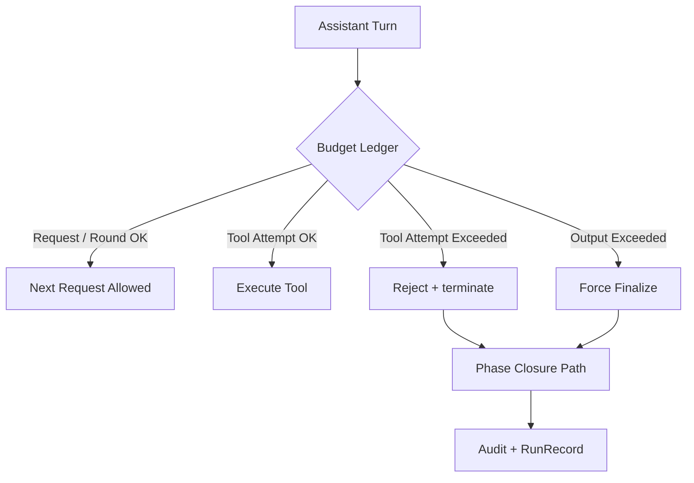

---

## 5. Context、工具与 Ledger 设计

### 5.1 Diff-first + Lazy Pull

目标态保留当前主线方向：

```text
初始必加载：Diff
按需拉取：Symbol / File / References / Call Chain / Rule / History
```

不在循环前默认注入全仓，不在每轮改写历史。动态内容只追加。

### 5.2 动态工具 profile

引入 `KnowledgeResolver`：

```text
core-5:
  get_diff / get_symbol / get_file
  / find_references / get_call_chain

extended-7:
  core-5 + search_rule + search_history
```

规则：

- 空语料时不暴露空知识工具；
- 一次 run 内 profile 固定；
- 审计记录 `toolProfile / knowledgeSource / knowledgeVersion`；
- Zone A golden bytes 按 profile 分别冻结。

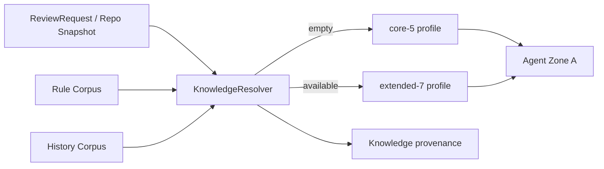

### 5.3 Ledger v2

目标 LedgerEntry：

```text
key
runId
toolCallId
messageId
kind
requestedRange
deliveredRange
contentVersion
contentHash
complete
charCount
hitCount
lastHitAt
```

身份键：

```text
kind
+ canonical tool arguments
+ contentVersion / contentHash
+ requested delivery scope
```

引用必须反映真实送达：

```text
Already loaded: ctx#003
  file src/Foo.java:100-180
  delivered 100-180 of requested 100-220
  complete=false
```

只有完整未截断读取才能声称 whole file loaded。

### 5.4 工具级截断策略

| 工具 | 策略 | 说明 |
|---|---|---|
| `get_file` | head | 保留请求区间开头，提示下一行区间 |
| `get_diff` | head + chunk suggestion | 大 diff 按文件/范围续读 |
| `get_symbol` | ranked head | 精确名、类型和成员优先 |
| `find_references` | ranked head | 声明和直接 usage 优先，保持稳定排序 |
| `get_call_chain` | hop-aware head | 优先 hop 1，再 hop 2 和 callee |
| `search_rule` | ranked head | 标题命中优先于正文 |
| `search_history` | ranked head | 与 rule 相同的稳定规则 |

禁止对模型可见的可执行工具结果做中间截断。

截断提示：

```ts
interface TruncationNotice {
  reason: "char_budget";
  budgetChars: number;
  shown: number;
  total: number;
  complete: false;
  nextCall?: {
    tool: string;
    args: Record<string, unknown>;
  };
}
```

### 5.5 工具规则与 Schema

- 工具规则从 `tools/registry.ts` 派生；
- schema 名称、顺序、字节和对象身份均稳定；
- 规则集合必须等于启用工具集合；
- 不把 run 特定数据写入 Zone A。

### 5.6 Context 与工具架构

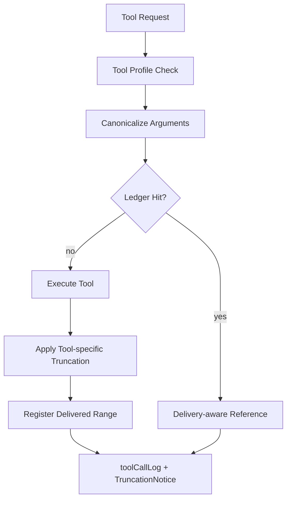

---

## 6. 缓存与 Provider 设计

### 6.1 稳定前缀

```text
[Zone A: system prompt + 工具 schema + 工具规则]
→ [Initial MR user message]
→ [Phase 1]
→ [tool calls / tool results / assistant replies]
→ [Phase 2]
→ ...
```

纪律：

- system prompt 在一次 harness 版本内稳定；
- 工具 schema 顺序和字节稳定；
- 初始 MR 后只追加，不重排；
- 任何 prune、compaction 或改写都作为显式缓存事件报告。

### 6.2 缓存合同探针

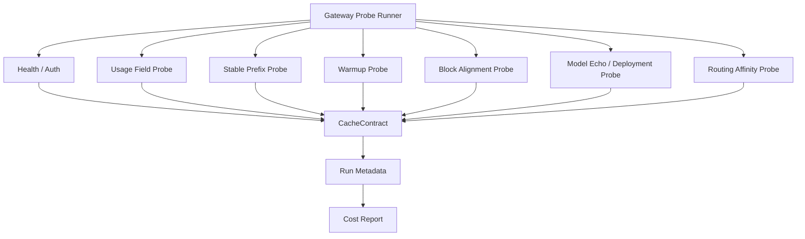

### 6.3 Provider affinity 与 reasoning echo

- 缓存是单机/缓存域状态，负载均衡可能让命中归零；
- provider 探针应检测或至少标注 route affinity；
- reasoning echo 先做 wire 观测，再考虑 never / tool / always 消融；
- 未拿到证据前，不假设某一种 echo 策略更便宜。

---

## 7. 质量与评测设计

### 7.1 双层质量门

相对 C 锚的 S 级质量门：

```text
target.Recall >= C.Recall × 90%
target.Precision >= C.Precision × 100%
```

相对优化前基线的质量不劣化门：

```text
candidate.Recall >= baseline.Recall × 0.95
candidate.Precision >= baseline.Precision × 0.95
```

两条门都必须通过。

### 7.2 成本门

```text
E.totalTokens <= C.totalTokens × 30%
```

同时报告 CARC、cached、uncached、output 和尝试次数，不能用总 Token 单项掩盖输出或工具成本。

### 7.3 有界性门

```text
attemptedToolCalls <= MAX_TOOL_ATTEMPTS
requests <= MAX_REQUESTS
outputTokens <= OUTPUT_BUDGET
```

### 7.4 评测矩阵

| 维度 | 必测内容 |
|---|---|
| 质量 | rule / judge 的 Recall、Precision、F1、Finding 数 |
| 成本 | cached、uncached、output、totalTokens、CARC |
| 工具 | executed、attempted、skipped、空语料调用 |
| 缓存 | cacheHit、provider contract、价目表 |
| 稳定性 | 冷/热分层、重复次数、置信区间 |
| 可复现 | 数据集、模型、provider、时间窗、脚本锚点 |

### 7.5 外部通用 Agent 基线

C 锚是上下文实验组，不是通用 Agent。要证明“通用 Agent 的 20~30%”，必须另做：

- 同模型；
- 同数据集；
- 同真值；
- 同判定链；
- 同 provider / 时间窗；
- 通用 Agent 实际运行。

---

## 8. 长上下文与后续扩展设计

### 8.1 Compaction

触发条件：

- 大 MR；
- 多文件扩展；
- 多轮追问；
- 历史接近窗口预算。

要求：

- 独立摘要请求；
- 结构化摘要；
- 不切断 tool call / tool result 配对；
- 失败回退 prune；
- 摘要成本计入 CARC；
- 被删除内容同步回撤 Ledger。

### 8.2 Repo map

若未来重启 Zone B：

- 按 token 而非符号数；
- 按顶层组件公平分配；
- 确定性排序；
- 显式截断；
- 排除 vendored / generated / test-data；
- 纳入 golden bytes 测试。

### 8.3 Artifact 引用

```text
artifact://<runId>/<refId>
```

用于替代把大工具结果反复塞入上下文。必须与审计、生命周期和访问控制一起设计。

### 8.4 子 agent

只有大 MR / 多语言阶段再引入。必须同时提供：

- `ownUsage`；
- `totalUsage`；
- `attributedChildUsage`；
- 父上下文峰值；
- 整棵树 CARC。

---

## 9. 竞争力机制对照与设计取舍

本节参考《ReviewAgent 竞争力演进方案》的“2. 三维机制对照总表”，只保留与 Token 成本、成本归因和直接支撑成本控制的 Loop 机制。

| 维度 | 机制 | 本仓 E-only 现状 | whale-pod | prime-agent | 本方案判断 | 优先级 / 落点 |
|---|---|---|---|---|---|---|
| Token | 成本报告 | 🟡 有 usage 和审计，没有四行主表 | ✅ fresh-billed 四行 + cost | 🟡 有 usage，偏总账 | 先统一“省的是什么钱” | **P0-1 / P0-2** |
| Token | 前缀字节纪律 | ✅ Zone A 稳定 + golden bytes | ✅ 稳定前缀 + append-only | 🟡 依赖 provider API | 保持并补不变量测试 | **保持 + P1-2** |
| Token | Schema 对象身份 | 🟡 字节稳定，对象同一性未锁定 | ✅ registry 对象复用 | 🟡 工具定义内聚 | 增加对象/字节同一测试 | **P1-2** |
| Token | 重复读取去重 | 🟡 描述键 Ledger，dedup 0% | ✅ 身份键 + 送达 + complete | ❌ 无，靠压缩 | 先修结构再消融 | **P0-5** |
| Token | 工具输出截断 | 🟡 仅行前缀 8K chars | ✅ head/tail/middle + 续读 | ✅ head/tail + 大输出 | 文件 head，检索 ranked-head | **P0-6** |
| Token | 工具规则 | ✅ 固定，但规则与定义分离 | ✅ 规则随工具集派生 | ✅ 工具描述内聚 | 从注册表派生规则 | **P1-1** |
| Token | 空工具控制 | ❌ 空 rule/history 仍暴露 | ✅ 按工具集裁剪 | 🟡 固定技能面 | 空语料 core-5 | **P0-4** |
| Token | 缓存计量与价格 | ❌ 无价目表、无 N/A 契约 | ✅ measured/unknown + 价目 | 🟡 provider 内建成本 | 报告带价目与时间窗 | **P0-2 / P0-7** |
| Token | Provider affinity | ❌ 未探测缓存域 | ✅ provider pin | 🟡 service tier | 先探测和标注 | **P0-7** |
| Token | Reasoning echo | 🟡 effort 锁 high | ✅ 三档策略 | 🟡 子调用可继承 | 先观测再消融 | **P1-6** |
| Token | 离线 prefix 预测 | ❌ 无 reusable-prefix 环 | ✅ 离线 + 在线 MAE | ❌ 无统一评测 | wire 预测 + cacheRead 对账 | **P1-3** |
| Token | Context-as-variable | ❌ 无 REPL/句柄 | 🟡 压缩替代 | ✅ REPL 持久变量 | 不引入 REPL，探索 artifact | **P1-4** |
| Token | 上下文压缩 | ❌ 当前不需要 | ✅ 结构化摘要 + prune | ✅ incremental + split-turn | 大 MR 时引入 | **P2-1** |
| Token | Repo map | ❌ Zone B 已退役 | ✅ token 预算 + 公平分配 | ❌ 无 | 大 MR 时再引入 | **P2-2** |
| Token | 子调用 usage 归账 | ❌ 当前无子 agent | ❌ 无 | ✅ own/total + child | 先定义归账 | **P2-3** |
| Loop | 请求 / 尝试预算 | 🟡 只有执行工具上界 | ✅ 步数上限 + 明确停止 | ✅ 重试/overflow 状态机 | 增加三层预算 | **P0-3** |
| Loop | 失败分类与重试 | 🟡 瞬时错误可能终局化 | ✅ 状态码 + 无输出才重试 | ✅ 9 类失败 + overflow | 首字节前有限重试 | **P1-5** |
| Loop | 停止原因 | 🟡 有 truncated/reason | ✅ 明确停止文案 | ✅ 多终态 | 模型终止与预算截断分层 | **P0-3 / P0-6** |
| 评测 | 可证伪消融 | 🟡 Demo 有数据，主线缺入口 | ✅ 离线 + 在线 | ❌ 无统一评测 | 主线恢复只读分析 | **P0-1 / P0-2** |
| 自进化 | 经验沉淀与 refine | ❌ 未实现 | ❌ 无 | ✅ /refine + 回滚 | 不纳入当前 Token 优化 | **范围外** |

设计取舍：

1. 本仓已有稳定前缀、证据闸和审计骨架，优先补细节，不重做架构；
2. P0 先解决可观测性和 attempt 封顶，再做工具和缓存优化；
3. Ledger、截断和规则派生都必须通过质量门；
4. Compaction、Repo map、Artifact 和子 agent 不进入当前中小 MR 主线。

---

## 10. 设计边界

目标态的有效域：

- Java 单语言；
- 静态源码快照，零构建；
- 中小 MR；
- 单模型主检视链；
- 单 provider / 网关配置；
- 单缺陷引入类评测集；
- 未启用二遍 Verifier；
- 未验证多租户并发下的成本稳定性。

不得外推到：

- 无缓存计量的模型；
- 异步缓存或块对齐未知的企业网关；
- 大 MR、多语言仓库；
- 通用 Agent 的完整开发任务；
- 未记录 provider、模型部署版本和时间窗的历史数据。

---

# 第二部分：当前 E-only 基线

## 11. 当前 Token 消耗现状

### 11.1 E 与 C 对比

本地 `runs/phase2-pi` 是 pi 内核产出的 A–E 矩阵数据。该数据可辅助判断当前形态，但复现 runner 与指标链不在主线，因此属于“实测但未主线固化”。

| 指标 | E | C 锚 | E/C |
|---|---:|---:|---:|
| `totalTokens` | 129,516.9 | 373,900.4 | **34.6%** |
| `CARC` | 57,278 | 65,420 | **87.5%** |
| `cacheHitRate` | 60.6% | 85.6% | 不适用 |
| rule line Recall | 22.0% | 24.7% | 89.0% |
| rule line Precision | 22.3% | 30.1% | 74.0% |
| judge Recall | 59.6% | 53.9% | 110.6% |
| 当前判级 | B | BELOW_B | 不适用 |

当前结论：

1. judge Recall 高于 C，质量方向成立；
2. 总 Token 为 C 的 34.6%，尚未达到严格 30%；
3. CARC 为 C 的 87.5%，按成本解释仍有明显差距；
4. cacheHit 60.6%，未达到 S 级 85% 门槛；
5. 历史 B 配置和旧 Phase 2 main 数字不能代表当前 E。

### 11.2 单 run 画像

对 30 case × E × rep2/rep3 的 60 个单元复算：

| 观测量 | 结果 | 说明 |
|---|---:|---|
| `totalTokens` 均值 | 129,516.9 | 与 dashboard 热口径一致 |
| `totalTokens` 范围 | 49,037 ~ 427,071 | case 间差异很大 |
| 请求数均值 | 9.88 | 范围 8 ~ 19 |
| 首请求 wireBody 均值 | 8,696 chars | Zone A + MR + Phase 1 |
| 末请求 wireBody 均值 | 91,069 chars | 历史与工具结果累积后 |
| 已执行工具调用 | 固定 6 | 所有 run 都达到执行上限 |
| 工具尝试均值 | 11.52 | 含超预算后仍发起的调用 |
| 工具尝试最大值 | 22 | 单 run 内 |
| 预算耗尽 run | 60 / 60 | `TOOL_BUDGET_EXHAUSTED` 全覆盖 |
| 平均被跳过调用 | 5.52 / run | 约 48% 工具尝试未执行 |
| 空知识工具调用 | 87 次 | 分布在 38 / 60 个 run |
| 发生截断的 run | 32 / 60 | 共 47 次工具结果截断 |
| Ledger dedup ratio | 0% | 当前矩阵没有命中 |

### 11.3 成本问题归因

| 问题 | 证据 | 设计对应 |
|---|---|---|
| 请求历史持续膨胀 | 平均约 10 个请求，末请求约首请求 10 倍 | P0-3 |
| 工具尝试未被封顶 | 执行 6，尝试均值 11.52，最大 22 | P0-3 |
| 空知识工具浪费预算 | 87 次空语料调用 | P0-4 |
| Ledger 无收益证据 | dedup 0% | P0-5 |
| 截断后可能盲重读 | 47 次截断 | P0-6 |
| 缓存不可解释 | cacheHit 60.6%，缺 provider 合同 | P0-7 |

---

## 12. 当前 E-only 实现基线

### 12.1 执行链

```text
ReviewRequest
  → 服务端派生 configId = "E"
  → Zone A system prompt
  → 初始 MR user message（caseId + issueDescription + unified diff）
  → pi Agent + 七工具
  → 六阶段循环
  → Candidate Gate / Evidence Gate
  → RunRecord + wire 审计
```

当前代码入口：

- 运行组装：`packages/review-pi/src/run/review-run.ts`
- 六阶段循环：`packages/review-pi/src/loop/agent-review-loop.ts`
- 阶段与常量：`packages/review-pi/src/loop/phases.ts`、`packages/review-pi/src/loop/constants.ts`
- Zone A 提示词：`packages/review-pi/src/zonea/system-prompt.ts`
- 七工具注册与执行：`packages/review-pi/src/tools/registry.ts`、`packages/review-pi/src/tools/toolkit.ts`
- 工具结果预算与账本：`packages/review-pi/src/tools/result-budget.ts`、`packages/review-pi/src/tools/ledger.ts`
- Cache Break 观测：`packages/review-pi/src/loop/cache-break.ts`
- usage 映射：`packages/review-pi/src/provider/usage-map.ts`
- 审计与记录：`packages/review-pi/src/audit/audit-writer.ts`、`packages/review-pi/src/experiment/run-record.ts`

### 12.2 Context

当前是 `Diff-first + Lazy Pull`：

- 初始只加载 caseId、issueDescription 和 unified diff；
- 七工具从首轮起全部可见；
- RepoContext 在首次仓库工具调用时懒加载；
- 模型不调用仓库工具时不会扫描仓库；
- 单次工具结果默认 8,000 字符；
- 当前没有风险分级自动加载、固定预取、全仓注入或 compaction。

### 12.3 Loop

```ts
MAX_ROUNDS = 5
MAX_TOOL_CALLS = 6
TOOL_RESULT_BUDGET_CHARS = 8_000
```

当前 `MAX_TOOL_CALLS` 只限制实际执行次数。超预算调用返回 `Error: tool call budget exhausted` 后，循环仍可进入下一回合。

### 12.4 Cache

当前稳定面：

- system prompt 在一次 harness 版本内字节稳定；
- 七工具名称、顺序和 schema 字节稳定；
- 初始 MR 后只追加，不重排；
- `classifyCacheBreaks()` 纯观测前缀分歧。

当前限制：

- 缓存命中受 provider、网关路由、预热和块对齐影响；
- 不能按固定 1/30 价格跨 provider 承诺；
- 没有离线 reusable-prefix 预测；
- 没有 provider affinity 探针；
- 60.6% 命中率不足以证明目标已兑现。

### 12.5 Context Ledger

当前 E 启用 Ledger：

- 相同规范化工具请求第一次返回原文；
- 后续完全相同请求返回 `Already loaded: ctx#NNN (...)`；
- 读取失败不登记；
- Ledger 快照进入审计。

当前 dedup ratio 为 0%。这与有界循环中重复读取稀少一致，也说明 Ledger 需要先修身份键、送达范围和命中计数，再重新消融。

### 12.6 Evidence Gate

```text
Schema → English → Evidence → Verification → Duplicate ID
```

只有通过证据闸的候选才进入 Finding。质量侧仍以 Recall 和 Precision 双侧约束为准。

### 12.7 当前度量缺口

主线已有：

- 全量请求 wireBody 审计；
- usage 映射与累计；
- Cache Break 分类；
- 工具调用、阶段、拒绝和截断留痕；
- RunRecord 与审计文件；
- disposition KPI。

主线缺少：

- `src/metrics/tokens.ts`；
- `src/metrics/efficiency.ts`；
- `src/metrics/verdict.ts`；
- Phase 2 runner；
- judge 链；
- A–E 矩阵报告重建；
- 离线 prefix prediction；
- 通用 Agent 外部基线 runner。

---

# 第三部分：落地路线

## 13. 实施路线、预测与回测

所有 P0、P1、P2 事项都必须先通过第 1.3 节的质量回归门。Token 收益不能抵消超过 5% 的 Recall 或 Precision 劣化。

### 13.1 预测基线与目标阈值

预测基线取本地 `runs/phase2-pi` 中 30 case × E × rep2/rep3 的 60 个热口径单元：

| 指标 | 当前基线 |
|---|---:|
| E 平均 `totalTokens` | 129,517 |
| C 锚平均 `totalTokens` | 373,900 |
| 当前 E/C | 34.6% |
| 平均输入 Token | 113,115 |
| 平均输出 Token | 16,402 |
| 平均 CARC | 57,278 |
| 平均请求数 | 9.88 |
| 平均工具尝试 | 11.52 |
| 平均实际工具执行 | 6 |
| 预算耗尽 run | 60 / 60 |

以 C 锚为分母，目标阈值和所需降幅为：

| 目标 E/C | 对应平均 `totalTokens` | 相对当前 129,517 所需降幅 |
|---|---:|---:|
| 30% | 112,170 | 13.4% |
| 25% | 93,475 | 27.8% |
| 20% | 74,780 | 42.3% |

当前输出约占总 Token 的 12.7%。即使输出降为 0，当前输入仍略高于 30% 阈值。因此 P0 必须实质减少请求历史或输入注入，不能只依赖输出压缩。

### 13.2 `totalTokens` 预测区间

| 场景 | 预测平均 `totalTokens` | 预测 E/C | 相对当前降幅 | 质量风险 | 判断 |
|---|---:|---:|---:|---|---|
| P0 保守，attempt cap 12 | 115,000 ~ 123,000 | 31% ~ 33% | 5% ~ 11% | 低 | 达不到 30% |
| P0 完整，attempt cap 10 | 103,000 ~ 112,000 | 27.5% ~ 30% | 13.5% ~ 20.5% | 中 | 最可能达到 30% 附近 |
| P0 激进，attempt cap 8 | 95,000 ~ 105,000 | 25% ~ 28% | 19% ~ 27% | 较高 | 有机会进入目标区间 |
| P0 + P1 成功 | 88,000 ~ 103,000 | 23.5% ~ 27.5% | 20.5% ~ 32% | 中 | 有机会稳定进入目标区间 |
| 严格 20% | 约 74,800 | 20% | 约 42.3% | 很高 | 当前 P0 单独无法保证 |

主要预测假设：

1. attempts 封顶能同时减少请求数、assistant 输出和后续历史重发；
2. 空知识工具不再占用请求与 schema；
3. 截断和 Ledger 修复不会引入新的重读轮次；
4. 质量门能接受 aggressive 预算档，或至少不会将其拒绝；
5. 上述区间是组合效应，不能把单项节省简单相加。

### 13.3 CARC 预测区间

`totalTokens` 和 CARC 必须分开预测。缓存合同本身不会自动降低名义 `totalTokens`，但可能降低 CARC。

| 缓存情景 | 预测平均 CARC | 预测 CARC / C | 条件 |
|---|---:|---:|---|
| 缓存行为基本不变 | 47,000 ~ 52,000 | 72% ~ 80% | 主要收益来自 attempts 和请求减少 |
| cacheHit 提升到 75% ~ 85% | 36,000 ~ 45,000 | 55% ~ 69% | provider 固定、预热稳定、块对齐可复用 |
| P0 + P1 且缓存稳定 | 34,000 ~ 43,000 | 52% ~ 66% | 前缀预测、回传策略和归账同时生效 |

如果只增加 P0-7 探针而不改变网关路由、预热和前缀复用，不能假设 CARC 会按第三行改善。

### 13.4 预测成立的必要条件

- 同一数据集、模型、provider、判定链和时间窗；
- 使用 rep2+ 热口径，rep1 冷口径单列；
- Recall 与 Precision 相对基线下降都不超过 5%；
- attempts、requests、output 的新预算真实触发并停止后续请求；
- 空知识工具被裁剪或接入真实语料；
- 不通过少报 Finding 换取 Token 下降；
- 报告同时给出 cached、uncached、output、CARC 和请求数。

任何一项不满足，预测区间就应视为失效，而不是通过调整解释方式保留结论。

### 13.5 实施后回测记录

实施完成后按下表填写真实结果。误差统一使用：

```text
predictionError = (actual - predictedMidpoint) / predictedMidpoint
```

| 预测 ID | 日期 / commit | 场景 | 预测 `totalTokens` | 实际 `totalTokens` | 误差 | 预测 E/C | 实际 E/C | 预测 CARC | 实际 CARC | Recall Δ | Precision Δ | 是否通过 |
|---|---|---|---:|---:|---:|---:|---:|---:|---:|---:|---:|---|
| F-P0-C12 | 待填 | P0 attempts <= 12 | 119,000 | 待填 | 待填 | 31.8% | 待填 | 49,500 | 待填 | 待填 | 待填 | 待填 |
| F-P0-C10 | 待填 | P0 attempts <= 10 | 107,500 | 待填 | 待填 | 28.8% | 待填 | 48,000 | 待填 | 待填 | 待填 | 待填 |
| F-P0-C8 | 待填 | P0 attempts <= 8 | 100,000 | 待填 | 待填 | 26.7% | 待填 | 46,000 | 待填 | 待填 | 待填 | 待填 |
| F-P01 | 待填 | P0 + P1 | 95,500 | 待填 | 待填 | 25.5% | 待填 | 40,000 | 待填 | 待填 | 待填 | 待填 |

回测要求：

- 每个场景至少使用与基线相同的 30 案和重复次数；
- 同时记录 cacheHit、请求数、attempts、executed 和 skipped；
- 若实际值落在预测区间外，必须记录原因：模型漂移、provider 漂移、预算未触发、质量门回退或数据集变化；
- 预测表只用于对照，不得替代实际质量和成本门。

### 13.6 P0 总体依赖

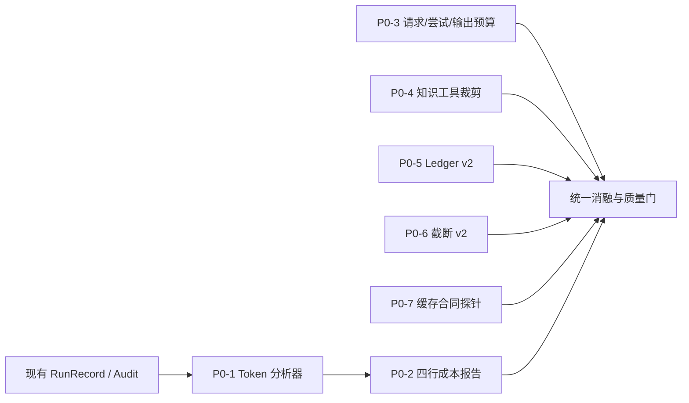

执行顺序：

1. 先做 P0-1 / P0-2，建立统一成本报告；
2. 并行做 P0-7 的网关口径调查；
3. 再做 P0-3、P0-4、P0-5、P0-6 的行为改造；
4. 最后用同一套报告和质量门做联合消融。

## 14. P0 七项详细设计

### P0 汇总

| 编号 | 事项 | 目标 | 验收门 |
|---|---|---|---|
| P0-1 | 恢复只读 Token 分析脚本 | usage → cached/uncached/output/CARC/请求与工具计数 | 单命令从 RunRecord 复算 |
| P0-2 | 报告改为四行主表 | 区分真正省钱的项 | cacheHit 不再单独作为结论 |
| P0-3 | 增加请求 / 尝试 / 输出硬上界 | 防止 attempts 继续膨胀 | attempts 不越界，截断显式 |
| P0-4 | 处理空知识工具 | 保留或删除均需证据 | 空语料调用大幅下降 |
| P0-5 | Ledger 补身份键、送达范围、complete、命中计数 | 先修机制再消融 | uncached 降 5%，Recall / Precision 劣化不超过 5% |
| P0-6 | 截断提示与检索结果语义修正 | 防止盲目重读 | 金样 + 不增加额外轮次 |
| P0-7 | provider / 网关缓存合同 | 解释 60.6% 命中率 | 字段、块对齐、预热、价目、路由留痕 |

### P0-1：恢复只读 Token 分析脚本

**问题**

主线只有 RunRecord 和 Audit，没有一键复算 Token、请求数、工具尝试数与执行/跳过数的脚本。

**设计**

建议落位（#51 落地；替换本节早期草案的 `src/metrics/` 设想）：

```text
scripts/analyze-token.ts          # 单命令入口（I/O 薄壳；pnpm analyze:token）
src/eval/analysis/                # 纯分析器（#37：零 fs / 零网络 / 零密钥）
tests/eval/analyze-cli.test.ts    # 进程级与确定性测试
```

输入支持：

- 单个 RunRecord JSON；
- 一个 experiment 目录；
- 一个 runs 根目录加 experimentId。

输出：

- `token-analysis.json`；
- `token-analysis.md`。


**验收门**

- 单命令可从单条 RunRecord、实验目录、`runs` 根 + experimentId 三种输入复算；本机无历史 `runs/` 数据，验收以离线夹具 + 进程级确定性测试为准（#49）；
- usage 与审计一致；
- executed / attempted / skipped 分开输出；
- 冷热分层不在主线分析器（属评测 campaign，见 #49 §1）；
- 输出确定；
- 不读 key，不联网。

**回滚**

纯只读工具，无生产行为回滚面。

### P0-2：报告改为 fresh-billed 四行主表

**问题**

当前容易只用 `totalTokens` 和 `cacheHitRate` 下结论，无法说明节省来自缓存、未缓存输入、输出还是工具。

**设计**

主报告固定四行：

```text
cachedInputTokens
uncachedInputTokens
outputTokens
CARC
```

辅助字段：

```text
totalTokens
cacheHitRate
requests
attemptedToolCalls
executedToolCalls
skippedToolCalls
toolCostTokens
retryCostTokens
summaryCostTokens
```

缺价目表时 `currency` 为 null（N/A）；`retryCostTokens` / `summaryCostTokens` 在对应机制落地前恒 null（N/A，不记 0）。

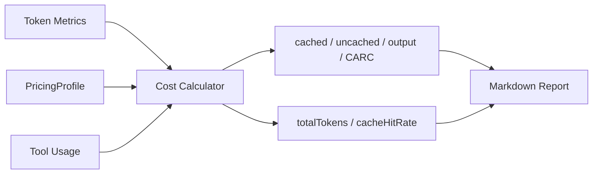

**验收门**

- 任一机制能回答“省的是 cached、uncached、output 还是工具次数”；
- 高 cacheHit + 高 totalTokens 不会被误判为成本优化；
- 无缓存计量时输出 N/A；
- 重试、摘要、子调用成本独立（机制未落地前记 N/A）；
- 缺价目表时标记 currency unavailable。

**回滚**

纯报告层，保留旧字段直到核对完成。

### P0-3：增加请求、尝试与输出硬上界

**问题**

`MAX_TOOL_CALLS=6` 只限制执行次数。当前 60 个采样 E run 全部触发预算耗尽，attempts 均值 11.52，最大 22。

**设计**

预算维度：

```ts
MAX_REQUESTS
MAX_ROUNDS
MAX_EXECUTED_TOOL_CALLS
MAX_TOOL_ATTEMPTS
MAX_OUTPUT_TOKENS
```

建议值：

| 预算 | 安全上界 | 优化候选 |
|---|---:|---:|
| `MAX_REQUESTS` | 24 | 16 / 20 / 24 |
| `MAX_ROUNDS` | 5 | 5 |
| `MAX_EXECUTED_TOOL_CALLS` | 6 | 4 / 6 |
| `MAX_TOOL_ATTEMPTS` | 12 | 8 / 10 / 12 |
| `MAX_OUTPUT_TOKENS` | 48,000 | 32,000 / 40,000 / 48,000 |

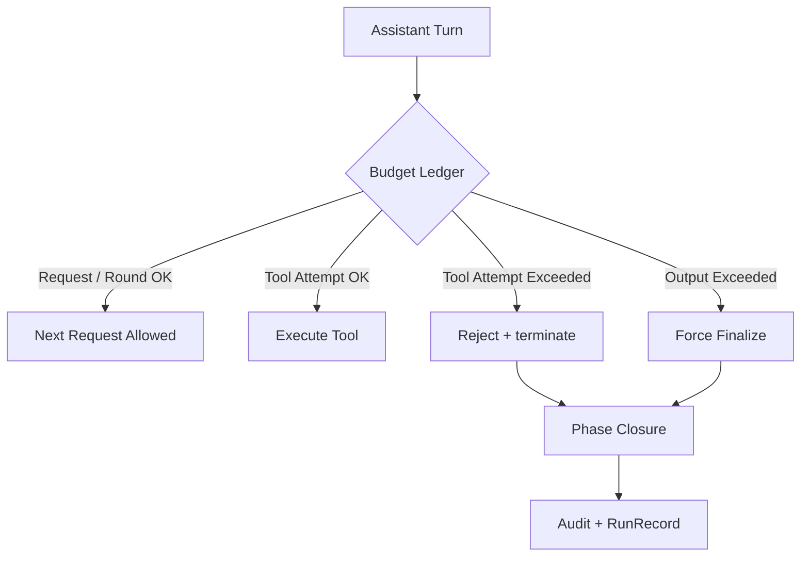

**验收门**

- 历史样本重放时 attempts 不超过配置；
- 超预算后不出现新请求；
- 截断原因可区分；
- Recall / Precision 劣化不超过 5%；
- 未触发预算时 wire 不变。

**回滚**

实验环境启用候选预算，生产先保留安全上界。

**落地记录（#53，2026-11-12）**

- 预算载体收敛为内核内部输入 `ReviewBudget`（`packages/review-pi/src/loop/budget.ts`），命名以 ADR-0018 为准：`maxRequests` / `maxRounds` / `maxExecutedToolCalls` / `maxToolAttempts` / `maxOutputTokens`；缺省 24 / 5 / 6 / 12 / 48,000 为安全上界。只经 `runReview` 内部输入注入，协议 v3、CLI 参数与环境变量零新增。
- #53 只落地注入面与计数：`maxRounds` 与 `maxExecutedToolCalls` 在既有收口点生效（原 `MAX_ROUNDS` / `MAX_TOOL_CALLS` 常量并入缺省档）；`maxRequests` / `maxToolAttempts` / `maxOutputTokens` 的收口语义分别由 #55、#54、#55 落地。
- 审计新增可选 `stopReason`（审计顶层与 RunRecord `AuditLight` 尾部），新 run 恒写；#53 先产出 `MODEL_COMPLETE` / `MAX_ROUNDS_REACHED`，其余枚举值随 #54 / #55 在各自收口点写入。历史记录缺键按 `MODEL_COMPLETE` 解释，不回填、不改写。
- requests / attempted / executed / skipped 不新增审计计数器：继续由 `phaseLog` 与 `toolCallLog` 派生（ADR-0018 §1），分析器口径不变。
- 未触发预算的 run 与基线 wireBody 逐字节一致（行为缝测试锁定）。

**落地记录（#54，2026-11-12）**

- 尝试闸前移到 `beforeToolCall`（被拦调用不进入 `execute`）：attempt 按模型发出的 toolCall 内容块计数（含被拒调用），整批判定——本批放行后累计尝试达到上限时，批内全部结果携带 `terminate`，pi 内核据此终止本批并消费收尾 follow-up。
- 超尝试预算的调用应答 `Error: tool attempt budget exhausted`；attempts 耗尽后 append-only 注入 `FORCED_FINALIZATION_INSTRUCTION`（每阶段至多 2 次，阶段切换重置）。
- 终止原因分流：收尾注入用尽后模型仍只发工具调用 → `TOOL_ATTEMPTS_EXHAUSTED`；收尾后返回空文本 → `PHASE_FORCED_INCOMPLETE`。两种终态 `truncated=true`；收尾成功则阶段照常完成、`truncated` 不翻转。
- 审计 `truncationReasons` 新增事件 `TOOL_ATTEMPTS_EXHAUSTED`（与 StopReason 同名，只作事件留痕）；执行预算路径的应答文案与 wire 字节不变。
- 行为缝测试：`packages/review-pi/src/loop/forced-finalization.test.ts`（收尾指令、整批 terminate、每阶段 2 次上限、truncated 表驱动）；run 级落盘见 `review-run-budget.test.ts`。

**落地记录（#55，2026-11-12）**

- 请求预算在阶段边界生效：边界处以剩余请求（`maxRequests − 已发请求数`）判定——下一阶段仍在第 1–4 阶段时，剩余不足以按常规序推进到裁决就跳过尚未完成的前四阶段直入候选；被跳过阶段逐条写 `phaseLog`（`requestCount = 0` + note），`truncationReasons` 记 `REQUEST_BUDGET_PHASES_SKIPPED`。
- 候选与裁决保底 2 请求：进入候选前剩余 < 2 或跳过时连保底都不足 → 不再开始候选，`stopReason = MAX_REQUESTS_REACHED`（`truncated = true`）；候选 → 裁决之间不设请求闸，裁决允许完成。轮次边界视同阶段边界；跳过本身不翻转 `truncated`。
- 输出预算只做事后判定：阶段完成后累计 `usage.outputTokens` 严格超限才在边界停止后续请求（含候选 → 裁决之间；5/6 保底不豁免），`stopReason = OUTPUT_BUDGET_EXHAUSTED`、`truncated = true`；wire 不新增 `max_tokens`，已完成阶段文本保留。裁决收尾且模型声明 complete 时按 `MODEL_COMPLETE` 收尾。
- 缺省请求预算 24 先于 5 轮上界（30 请求）收口：不完成脚本缺省停在 4 轮、`MAX_REQUESTS_REACHED`。这是有意的控制面行为；轮次上界测试改为显式放宽 `maxRequests` 以隔离被测语义。
- 行为缝测试：`packages/review-pi/src/loop/request-output-budget.test.ts`（跳保底、硬停、候选后完成、输出边界、wire 无 `max_tokens`）；run 级落盘见 `review-run-budget.test.ts`。

### P0-4：处理空知识工具

**问题**

`review.search_rule` 和 `review.search_history` 在生产入口没有语料。38 / 60 个 run 曾调用空工具，共 87 次。

**设计**

```text
core-5:
  get_diff / get_symbol / get_file
  / find_references / get_call_chain

extended-7:
  core-5 + search_rule + search_history
```

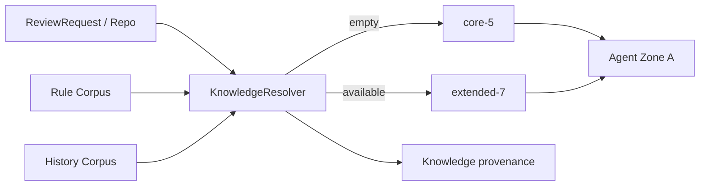

**验收门**

- 空语料 run 不再调用空工具；
- 两 profile 有 golden 测试；
- 工具调用有效产出率提升；
- Recall / Precision 劣化不超过 5%；
- 审计能说明 profile 选择原因。

**回滚**

保留七工具对照组。裁剪失败时回退并接入真实知识源。

### P0-5：Context Ledger 身份键、送达范围、complete 与命中计数

**问题**

当前 Ledger 只有 `kind + description`，不能区分请求范围、实际送达和完整性，dedup 为 0。

**设计**

```text
key
runId
toolCallId
messageId
kind
requestedRange
deliveredRange
contentVersion
contentHash
complete
charCount
hitCount
lastHitAt
```

引用必须显示真实送达范围：

```text
Already loaded: ctx#003
  file src/Foo.java:100-180
  delivered 100-180 of requested 100-220
  complete=false
```

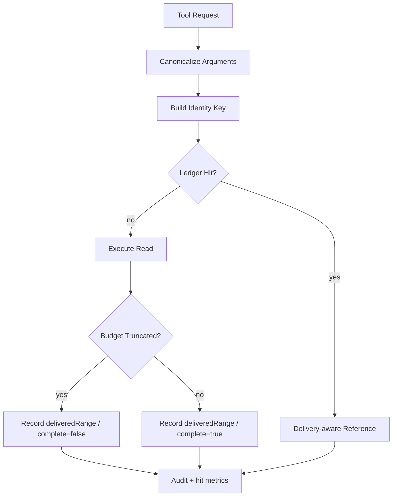

**验收门**

- 同请求重复读取命中；
- 不同行区间不会错误命中；
- 截断读取不会声称全文件已加载；
- 审计有 ledgerHits / ledgerMisses / savedCharsEstimate；
- uncached 下降至少 5% 且质量门通过；
- 若仍无收益，默认关闭或实验开关。

**回滚**

新旧 Ledger 双实现，由实验开关选择。

**落地记录（#56，2026-11-12）**

- 实现载体：契约 `packages/review-pi/src/contracts/ledger.ts`、实现 `packages/review-pi/src/tools/ledger.ts`。命中桶按 `resourceKey`（工具名 + 决定资源内容的参数，不含请求范围）分组——整读与子区间读同桶才能做覆盖判定；`kind` 只进条目身份键。`requestedRange / deliveredRange` 为 1-based 闭区间（`endLine = null` 表示到结尾），整结果工具 `requestedRange` 为 null、完整送达时 `deliveredRange` 为 null。
- 覆盖命中：只有 `deliveredRange ⊇ requestedRange` 才返回引用。范围工具另记 `totalLines`：起点 / 终点越过文件总行数一律不覆盖；整文件完整送达后子区间命中；截断整文件（delivered 1-N）不覆盖整文件请求，重复整读会重跑并登记新条目；`get_file` 的 `endLine` 越界 clamp 同样 `complete=false`、未覆盖原请求。不做部分命中拼接。
- 条目字段：`key / kind / description / requestedRange / deliveredRange / complete / contentHash / contentVersion / charCount / totalLines / hitCount / lastHitAt`；内容哈希与版本进入身份键但不参与预读查询；`runId / toolCallId / messageId` 暂不落位（Agent 桥接可后续追加）。引用单行：`Already loaded: ctx#NNN (<请求回显>; delivered <送达范围> of requested <请求范围>; complete=<bool>)`，`complete` 描述条目自身送达完整性，是否可引用由覆盖关系单独保证。
- 审计新增可选尾键 `ledgerStats: { ledgerHits, ledgerMisses, savedCharsEstimate }`（有账本查询时在场，零工具 run 省键）。`savedCharsEstimate`：精确重复取送达字符数，覆盖子区间按请求/送达行数比例折算（`endLine = null` 用 `totalLines` 折算）。
- 正常未命中路径渲染层未改：七工具输出逐字节不变（`toolkit.test.ts` 渲染断言与全链黄金不变）；行为缝见 `tools/ledger.test.ts`、`tools/toolkit.test.ts` 与 run 级 `review-run.test.ts`。

### P0-6：截断提示与检索结果语义修正

**问题**

当前只保留行前缀。检索结果是排序列表，前缀截断会丢失后面的有效结果。当前 32 / 60 个 run 发生截断，共 47 次。

**设计**

| 工具 | 策略 |
|---|---|
| `get_file` | head + next line range |
| `get_diff` | head + chunk suggestion |
| `get_symbol` | ranked head |
| `find_references` | ranked head |
| `get_call_chain` | hop-aware head |
| `search_rule` | ranked head |
| `search_history` | ranked head |

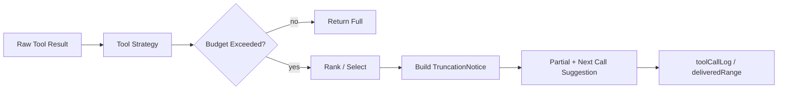

**验收门**

- 所有截断都有 shown/total/budget；
- 文件读取有下一行区间；
- 检索不让前缀静默吃掉关键命中；
- 截断金样稳定；
- 不增加额外工具轮次；
- Recall / Precision 劣化不超过 5%。

**回滚**

按工具逐个迁移，失败时恢复 head-only。

### P0-7：Provider / 网关缓存合同

**问题**

当前 cacheHit 60.6%，但没有记录 provider 版本、字段族、预热、块对齐、路由亲和和价格。

**设计**

```ts
interface CacheContract {
  provider: string;
  endpointKind: string;
  requestedModel: string;
  respondedModel?: string;
  deploymentVersion?: string;
  usageFieldFamily:
    | "deepseek-native"
    | "openai-cached-tokens"
    | "unknown";
  cacheMetering: boolean;
  cacheBlockTokens?: number;
  cacheWarmupMs?: number;
  providerAffinityRequired?: boolean;
  cacheHitPrice?: number;
  cacheMissPrice?: number;
  cacheWritePrice?: number;
  currency?: string;
  priceValidFrom?: string;
  measuredAt: string;
}
```

探针：

1. health / auth；
2. usage 字段族；
3. stable prefix；
4. warmup；
5. block alignment；
6. model echo / deployment；
7. routing affinity。

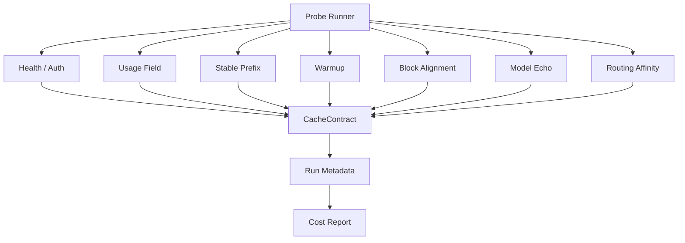

**验收门**

- 不记录 key；
- 缺字段时 cacheMetering=false / N/A；
- 能区分冷缓存和服务端未命中；
- CacheContract 进入报告；
- currency / price / time window 完整；
- 无亲和证据时不得声称跨网关可复现。

**回滚**

探针纯观测，网关拒绝时标记 unknown，不影响主链。

## 15. P1/P2 路线

### P1

| 编号 | 事项 | 目标 | 前置 |
|---|---|---|---|
| P1-1 | 工具规则从注册表派生 | 规则与工具集合不漂移 | P0-6 |
| P1-2 | schema 对象身份测试 | 防前缀重排 | P0-2 |
| P1-3 | 离线 reusable-prefix 预测 | 与线上 cacheRead 对账 | P0-1 |
| P1-4 | artifact 引用 | 替代大结果反复入历史 | P0-5 |
| P1-5 | 首字节前薄重试 | 提升成功率且可归账 | P0-1 |
| P1-6 | reasoning echo 观测与消融 | 找请求体积与缓存影响 | P0-7 |

### P2

| 编号 | 事项 | 目标 | 前置 |
|---|---|---|---|
| P2-1 | Compaction | 控制超长历史 | 大 MR 立项 |
| P2-2 | Repo map 预算 | 可预算仓库摘要 | 大 MR 立项 |
| P2-3 | 子 agent 与 usage 归账 | 控制父上下文和整树成本 | P2-1 |
| P2-4 | Cache-aware 路由推荐 | 只产证据，不自动切换 | P0-7 / P1-3 |

---

## 16. 后续优化候选池

本章记录尚未进入 P0/P1/P2 承诺路线的优化设想。候选项必须有可测收益、可回滚路径和明确的质量门，不能把“看起来能省 Token”直接写成实施承诺。

候选状态统一标记：

| 状态 | 含义 |
|---|---|
| **候选** | 有理论或局部证据，尚未完成本仓消融 |
| **待立项** | 已具备明确机制，等待单独 ADR / spec |
| **观察** | 先补遥测或离线分析，不改变行为 |
| **合并已有路线** | 与现有 P1/P2 重复，只补充，不另立编号 |

### 16.1 候选优化组合图

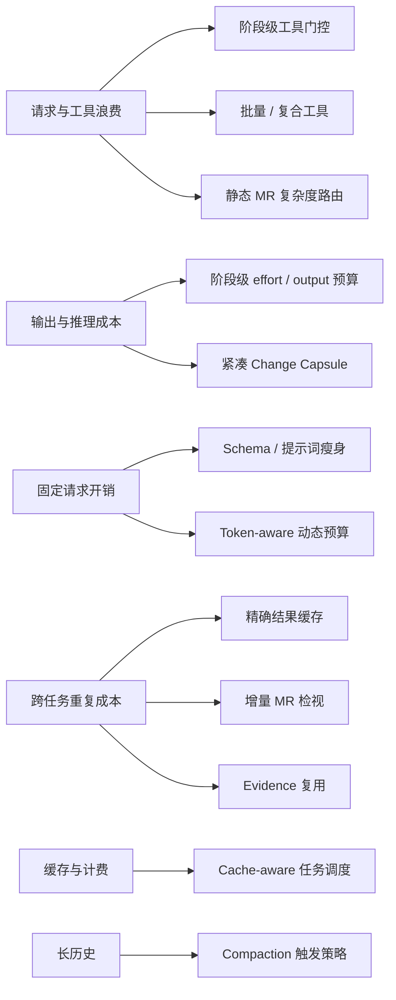

### 16.2 候选优先级表

预计收益为单措施相对当前 E 基线的经验区间，存在重叠，不能简单相加。

| 编号 | 候选措施 | 主要作用 | 预计收益 | 主要风险 | 前置 | 状态 |
|---|---|---|---:|---|---|---|
| C-01 | 阶段级工具门控 | Phase 1-2 和 Phase 6 禁止探索，减少早期/末期无效工具 | total -5% ~ -12% | 高风险 case 取证延后 | 无 wire 改动；先做 phase gate 测试 | **候选** |
| C-02 | 批量 / 复合工具 | 一次返回多文件、多符号或复合上下文，减少请求 | total -5% ~ -12% | 工具协议与 golden 变化 | 工具 schema 版本化 | **候选** |
| C-03 | 静态 MR 复杂度路由 | 低复杂度 MR 使用轻 profile，高复杂度保留完整工具 | total -3% ~ -10%；低风险 case -15% ~ -30% | 误判风险导致漏检 | 确定性 diff 特征与质量消融 | **候选** |
| C-04 | 阶段级 reasoning / output 预算 | Phase 1-4 降低输出，Phase 5 保留高推理 | total -5% ~ -15% | 影响 JSON 完整性和推理质量 | 逐阶段 output cap | **候选** |
| C-05 | 紧凑 Change Capsule | 预注入变更符号、行号和直接调用者，减少首轮探索 | total -5% ~ -15% | 固定上下文增加，若不能减少请求则亏损 | 与 B 预取区分，只做最小胶囊 | **候选** |
| C-06 | 工具 schema / 提示词瘦身 | 降低每个请求的固定输入字节 | total -2% ~ -6% | Zone A golden 变化 | 注册表派生规则 + golden 版本化 | **候选** |
| C-07 | Token-aware 动态预算 | 使用 provider tokenizer 或保守近似替代 chars/4 | total -2% ~ -5% | tokenizer 不可得时估计误差 | 分析脚本接入 tokenizer | **候选** |
| C-08 | Cache-aware 任务调度 | 同仓、同模型、同 provider 连续执行 | total 基本不变；CARC -10% ~ -30% | 网关路由不可控 | CacheContract + provider affinity | **待立项** |
| C-09 | 精确结果缓存 | 相同 repo + diff + issue + model + prompt 复用结果 | repeat / duplicate run 可 -30% ~ -100%；unique run 为 0 | 结果陈旧、幂等与权限 | 内容哈希、版本失效、租户隔离 | **待立项** |
| C-10 | 增量 MR 检视 | 复用旧 commit 的 Finding 和证据，只审查增量 | 增量任务 -20% ~ -60% | 基线漂移、证据失效 | 跨 commit 快照与证据版本 | **待立项** |
| C-11 | Evidence 复用 | 已验证 Finding 不重复解释和验证 | 长会话 -5% ~ -15%，当前单次场景待测 | 证据过期、错误继承 | evidence sourceHash + verifier | **观察** |
| C-12 | Compaction 触发策略 | 仅在长历史 / 大 MR 时压缩 | 大 MR total -10% ~ -20% | 破坏前缀，CARC 可能上升 | 合并入 P2-1，不另设默认 | **合并已有路线** |

### 16.3 推荐推进顺序

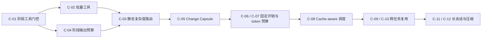

第一优先组：

1. `C-01` 阶段级工具门控；
2. `C-02` 批量 / 复合工具；
3. `C-04` 阶段级 reasoning / output。

这三项最有机会补上当前 P0 从约 27%~30% 继续下降到 22%~25% 的差距。

### 16.4 候选准入条件

任何候选进入下一阶段前必须满足：

1. **可归因**：能说明节省来自 requests、attempts、cached、uncached、output 还是 tool cost；
2. **质量门**：Recall / Precision 相对基线劣化不超过 5%；
3. **可回滚**：有实验开关或稳定版本回退路径；
4. **不破坏边界**：不引入自由循环、写工具、REPL 或自动路由切换；
5. **可复现**：同数据集、模型、provider、判定链和时间窗；
6. **有样本意义**：不能以单个 case 或单次 demo 证明；
7. **成本完整**：重试、摘要、子调用和工具成本必须归账；
8. **预测更新**：进入正式路线时，必须新增预测 ID 和回测行，不能沿用本章经验区间。

### 16.5 与当前预测的关系

本章候选项**不进入**第 13.2 节的当前预测区间。当前预测只覆盖已定义的 P0/P1 路线。

如果候选项被批准进入主线：

1. 先分配新的 `F-*` 预测 ID；
2. 在 30 案矩阵上完成离线分析；
3. 再执行质量、Token、CARC 和有界性联合门；
4. 将结果写回第 13.5 节回测表；
5. 不得直接把候选的理论收益累加到现有预测。

### 16.6 明确不列为 Token 优化候选

- 工具并行执行：主要改善延迟，不减少请求或 Token；
- 无限增加工具轮次：改善覆盖但破坏有界性；
- 单纯提高 cacheHit：可能只是上下文膨胀；
- 无版本失效的结果缓存；
- 未通过迁移门的模型替换；
- 用截断或少报 Finding 换取 Token 下降。

---

## 17. 统一验收门

### 17.1 成本报告门

每次对照至少输出：

```text
requests
executedToolCalls
attemptedToolCalls
cachedInputTokens
uncachedInputTokens
outputTokens
totalTokens
cacheHitRate
CARC
truncationReasons
```

### 17.2 Token 门

```text
E.totalTokens <= C.totalTokens × 30%
```

### 17.3 质量门

相对 C 锚：

```text
E.Recall >= C.Recall × 90%
E.Precision >= C.Precision × 100%
```

相对优化前基线：

```text
candidate.Recall >= baseline.Recall × 0.95
candidate.Precision >= baseline.Precision × 0.95
```

两条门都必须通过。

### 17.4 缓存门

```text
cacheHitRate >= 85%
```

附带 provider、部署版本、字段族、预热、块对齐、路由和时间窗。

### 17.5 有界性门

```text
attemptedToolCalls <= MAX_TOOL_ATTEMPTS
requests <= MAX_REQUESTS
outputTokens <= OUTPUT_BUDGET
```

### 17.6 回归门

- Zone A golden bytes 不变；
- 相同输入审计可重放；
- 无变更时 Cache Break 为 0；
- 截断提示金样稳定；
- 不因成本优化丢失 Finding 或证据。

---

## 18. 结论

1. 当前 E 已经是可工作的生产形态，但 20~30% 仍是目标。
2. 当前主要 Token 问题不是没有缓存，而是请求数、工具尝试、空知识工具、长历史重发和 Ledger 收益未兑现。
3. 目标态顺序是先观测，再封预算，再修 Context / 工具，再解释缓存，最后才做长上下文扩展。
4. 任何 Token 优化都必须通过 Recall / Precision 质量门，最大劣化不超过 5%。
5. 最先落地的是 P0-1、P0-2、P0-3、P0-4，而不是直接恢复 B 的预取。

---

# 附录

## 附 A：当前机制与目标状态

| 机制 | 当前实现 | 目标态 |
|---|---|---|
| E-only 配置 | 已实现 | 保持 |
| Zone A 稳定提示 | 已实现 | 增加不变量测试 |
| 七工具固定 schema | 已实现 | 动态 core-5 / extended-7 |
| Diff-first | 已实现 | 保持 |
| RepoContext 懒加载 | 已实现 | 保持 |
| 工具结果预算 | head-only | 工具级策略 |
| 六阶段循环 | 已实现 | 保持 |
| 轮次上界 | 已实现 | 保持 |
| 工具执行上界 | 已实现 | 保持 |
| 工具尝试上界 | 未实现 | P0-3 |
| Ledger | 描述键，dedup 0% | 身份键 + 送达 + complete |
| Cache Break | 已实现 | 保持并接缓存合同 |
| usage 映射 | 已实现 | 四行报告 |
| RIE / CARC / 判定链 | Demo 线 | 只读分析入口 |
| 确定性预取 | Demo B | 不作为当前默认 |
| Provider affinity | 未实现 | P0-7 |
| Compaction / repo map | 未实现 | P2 |

## 附 B：参考吸收边界

从竞争力演进方案吸收：

- fresh-billed 四行报告；
- cacheHit 只作解释变量；
- provider 价目与时窗限定；
- 前缀字节纪律补强；
- 工具结果截断语义；
- Ledger 身份键、送达范围、complete、prune 回撤；
- 首字节前重试和停止原因分层；
- 离线 reusable-prefix 预测；
- 大 MR 阶段的 compaction、repo map、artifact 和 usage 归账。

不吸收到当前主线：

- 无限自由循环；
- Python REPL；
- 写工具；
- 自动自进化；
- 无证据的模型路由切换；
- 把历史 B 配置数字写成当前 E 成果。
